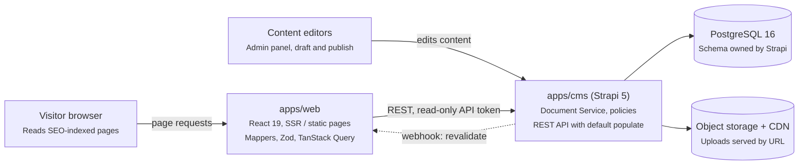
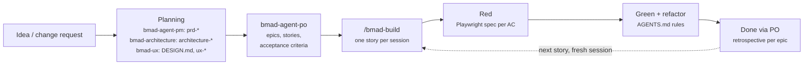

# Portfolio Platform — TypeScript, React & Strapi Conventions

> Source of truth for humans. Agents read the condensed rules in [`/AGENTS.md`](../AGENTS.md).

## Overview and assumptions

The portfolio moves from a Roots stack (Bedrock + Sage + Trellis) to a TypeScript monorepo: a React frontend reading a headless Strapi 5 CMS backed by PostgreSQL. This guide fixes the naming, folder, method and data-model rules so every contributor writes the same code.

Assumptions this guide is built on:

- **Strapi 5** (current major), TypeScript project, Document Service API and `documentId` as the public identifier.
- **React 19 + TypeScript strict**, rendered with SSR or static generation, because a portfolio depends on SEO. React Router (framework mode) or Next.js both fit; the patterns below are framework-neutral.
- **PostgreSQL 16+** as the only database, in every environment including local (no SQLite).
- **pnpm workspaces + Turborepo** for the monorepo.
- Tailwind CSS is kept from Sage 10, so styling knowledge carries over.

Three principles drive every rule below:

1. **Strapi is a data source, not the domain.** The frontend never renders raw Strapi payloads; a mapper turns them into domain models first.
2. **Content is modeled once, in Strapi.** No hand-made tables or columns in Postgres.
3. **Names describe intent.** A reader knows from a function name whether it can return nothing, throw, or hit the network.

## Architecture and monorepo layout

Two deployable apps share one repo: Strapi writes content, the web app reads it at build or request time, and a webhook tells the web app when to refresh.



Editors work only in Strapi; visitors only touch the web app, which calls Strapi server-side with a read-only token. Images load straight from the CDN by URL.

```text
portfolio/
  apps/
    web/              React frontend (SSR/SSG)
    cms/              Strapi 5 (TypeScript)
  packages/
    contracts/        domain types, Zod schemas, error classes, shared by both apps
    config/           shared tsconfig presets
    migrator/         WordPress → Strapi ETL scripts
  _bmad/              BMAD framework install (core files are never edited)
  _bmad-output/       BMAD planning artifacts: PRD, architecture, UX, epics, stories
  docs/
    conventions.md    this file
  design/             OpenPencil mockups (portfolio.fig) and exports/
  external/           original WordPress theme repo (gitignored, read-only, last resort)
  .kiro/              Kiro steering and MCP config
  AGENTS.md           condensed rules for coding agents
  CLAUDE.md           imports AGENTS.md for Claude Code
  DESIGN.md           visual system, owned by the BMAD UX skill
  docker-compose.yml  Postgres + cms + web for local work
  turbo.json
  pnpm-workspace.yaml
```

Dependencies point one way: apps depend on packages, never on each other. The web app knows Strapi only through its HTTP API and its own DTO types.

## Delivery workflow (BMAD)

Work is planned and delivered with the BMAD Method: planning skills produce the artifacts, the PO agent turns them into stories, and each story is implemented in one `/bmad-build` session that starts with failing Playwright specs.



### Who owns which artifact

| Artifact | Produced by | Lives in | Consumed by |
| --- | --- | --- | --- |
| `prd-*` | PM agent (`bmad-agent-pm`) | `_bmad-output/` | PO, architecture, build |
| `architecture-*` | `bmad-architecture` | `_bmad-output/` | build, reviewers |
| `DESIGN.md`, `ux-*` | `bmad-ux` | repo root / `_bmad-output/` | `apps/web` (via `apps/web/CLAUDE.md`) |
| Epics, stories, ticket status | PO agent (`bmad-agent-po`) | `_bmad-output/` | `/bmad-build` |
| `bmad:context` block | `bmad-project-context` | `AGENTS.md` | every agent session |
| Conventions (this file) | team, by hand | `docs/` | humans; agents via AGENTS.md |

### Rules

- **Story = what, AGENTS.md = how.** Acceptance criteria define behavior; this guide and AGENTS.md define naming, structure and testing. A conflict is flagged back to the PO or architecture skill, never resolved silently in code.
- **No code without a story** (or an explicit, scoped task). Implementation always runs through `/bmad-build`, one story per session; start a fresh session for the next one to keep context clean.
- **Planning decisions flow back to planning.** A change to the data model, API shape or architecture is proposed to `bmad-architecture` and recorded in `architecture-*` before code lands.
- **`DESIGN.md` has one owner.** It is generated and changed through `bmad-ux`; components follow it, and a visual change starts there.
- **The `bmad:context` block in AGENTS.md** is managed by `bmad-project-context` and holds only what is costly to rediscover (pitfalls, caveats, non-default conventions). Everything else in AGENTS.md is maintained by hand, outside the markers.
- **BMAD customization** goes in its config and customization files, not in the core files under `_bmad/`, so upgrades do not overwrite it.
- **Traceability:** every acceptance criterion maps to at least one test; the story id appears in the Playwright `describe` title and in the commit message.

## TypeScript conventions

One casing rule per kind of symbol, enforced by Biome's `useNamingConvention` and `useFilenamingConvention` (see `biome.jsonc`) so reviews never argue about it.

### Naming

| Symbol | Casing | Example |
| --- | --- | --- |
| Type, interface, class, enum | PascalCase, no `I` prefix | `Project`, `ProjectCardProps` |
| Function, method, variable | camelCase | `listProjects`, `projectSlug` |
| React component | PascalCase, one per file | `ProjectCard` |
| Hook | camelCase with `use` prefix | `useProjectBySlug` |
| Module-level constant | UPPER_SNAKE_CASE | `DEFAULT_PAGE_SIZE` |
| Boolean | `is` / `has` / `can` / `should` prefix | `isFeatured`, `hasCoverImage` |
| Event handler (inside component) | `handle` + event | `handleFilterChange` |
| Event prop (component API) | `on` + event | `onFilterChange` |
| File (non-component) | kebab-case | `project-mapper.ts`, `cms-client.ts` |
| File (component) | PascalCase | `ProjectCard.tsx` |
| Test file | source name + `.test` | `project-mapper.test.ts` |
| Strapi DTO type | `Strapi` prefix + entity | `StrapiProject` |

### Method verbs

The verb is a contract. Pick it by what the caller must handle, not by taste.

| Verb | Returns | Use when |
| --- | --- | --- |
| `get…` | `T`, throws `NotFoundError` | The item must exist (`getSiteSettings`) |
| `find…` | `T \| null` | The item may not exist (`findProjectBySlug`) |
| `list…` | `Paginated<T>` or `T[]` | A collection, with filters (`listProjects`) |
| `create…` / `update…` / `delete…` | the written entity / `void` | Writes; mirror Strapi's own verbs |
| `to…` / `map…To…` | a new shape, pure | Mappers (`toProject`, `mapStrapiMediaToImage`) |
| `build…` | a value, pure | Builders of queries or URLs (`buildProjectQuery`) |
| `assert…` | `asserts x is T` | Runtime guards that throw |
| `is…` / `has…` | `boolean` or `x is T` | Predicates and type guards |

Rules that differ from C#: no `Async` suffix (every network call is async in TS), no `Get` prefix on properties, and no `I` prefix on interfaces.

### Types

- `type` for unions, mapped types and DTOs; `interface` only for objects meant to be extended (component props may use either; pick `type` and stay consistent).
- No `any`. Use `unknown` at boundaries and narrow it with **Zod** schemas; derive the type with `z.infer`.
- No TS `enum`. Use string-literal unions or `as const` objects (smaller output, works with Strapi enumerations).
- Branded IDs for anything that crosses the API: `type DocumentId = string & { readonly __brand: 'DocumentId' }`.
- Discriminated unions for variants, with an exhaustive `switch` ending in an `assertNever(x)`.
- `tsconfig`: `strict`, `noUncheckedIndexedAccess`, `exactOptionalPropertyTypes`, `verbatimModuleSyntax`.

### Modules

- Named exports only; no default exports except where a framework requires them (route modules, Strapi factories).
- `import type { … }` for type-only imports.
- Path aliases: `@/` inside an app, `@portfolio/<package>` across packages.
- A folder exposes one `index.ts` public API; deep imports into another feature are lint errors.

### Errors

- A small error hierarchy in `packages/contracts`: `AppError` → `NotFoundError`, `ValidationError`, `CmsUnavailableError`.
- Services throw; UI boundaries catch. No `try/catch` that only logs and rethrows.
- For expected failures in pure code, return a `Result<T, E>` union instead of throwing.

## React frontend patterns

The frontend is organised by feature, and every CMS call flows through one path: client → query function → mapper → hook → component.

### Folder layout (`apps/web/src`)

```text
app/                 routes, layouts, providers (framework entry)
features/
  projects/
    api/             project-queries.ts, project-mapper.ts, strapi-project.ts
    components/      ProjectCard.tsx, ProjectGrid.tsx
    hooks/           use-project-by-slug.ts
    model/           project.ts (domain type + Zod schema)
    index.ts         public API of the feature
  pages/  blog/  navigation/
blocks/              one component per dynamic-zone block + registry.ts
shared/
  api/               cms-client.ts, query-keys.ts, strapi-types.ts
  ui/                design-system primitives (Button, Container, Image)
  lib/               pure helpers (format-date.ts, assert-never.ts)
```

### Data layer

```ts
// shared/api/cms-client.ts  (server-only module: runs during SSR/SSG)
import qs from 'qs';
import { CmsUnavailableError } from '@portfolio/contracts';

const CMS_URL = process.env.CMS_URL;
const CMS_TOKEN = process.env.CMS_TOKEN; // read-only API token, never VITE_/NEXT_PUBLIC_

export async function cmsGet<T>(path: string, query: object = {}): Promise<T> {
  const url = `${CMS_URL}/api/${path}?${qs.stringify(query, { encodeValuesOnly: true })}`;
  const res = await fetch(url, { headers: { Authorization: `Bearer ${CMS_TOKEN}` } });
  if (!res.ok) throw new CmsUnavailableError(res.status, path);
  return (await res.json()) as T;
}
```

```ts
// features/projects/api/project-queries.ts
import { cmsGet } from '@/shared/api/cms-client';
import type { StrapiCollection } from '@/shared/api/strapi-types';
import type { StrapiProject } from './strapi-project';
import { toProject } from './project-mapper';
import type { Project } from '../model/project';

export async function findProjectBySlug(slug: string): Promise<Project | null> {
  const res = await cmsGet<StrapiCollection<StrapiProject>>('projects', {
    filters: { slug: { $eq: slug } },
    status: 'published',
  });
  const [first] = res.data;
  return first ? toProject(first) : null;
}
```

- **TanStack Query** for caching; query keys come from one factory (`projectKeys.detail(slug)`), never inline arrays.
- **Mappers are the anti-corruption layer.** `toProject` validates the payload with Zod and returns the domain `Project`. Components never see `documentId`, `attributes`, or Strapi media URLs.
- The CMS token used by the frontend is a **read-only API token**, and only on the server (SSR). Never ship a token in a client bundle; for client-side fetches, use the public role with `find` / `findOne` only.

### Dynamic-zone rendering

Each page body is a list of blocks. A registry maps the Strapi `__component` UID to a React component, and the compiler checks that every block type is handled.

```tsx
// blocks/registry.tsx
import type { Block } from '@/features/pages/model/block';
import { assertNever } from '@/shared/lib/assert-never';
import { HeroBlock } from './HeroBlock';
import { RichTextBlock } from './RichTextBlock';
import { GalleryBlock } from './GalleryBlock';

export function renderBlock(block: Block) {
  switch (block.type) {
    case 'hero': return <HeroBlock key={block.id} {...block} />;
    case 'rich-text': return <RichTextBlock key={block.id} {...block} />;
    case 'gallery': return <GalleryBlock key={block.id} {...block} />;
    default: return assertNever(block);
  }
}
```

The mapper converts `blocks.hero` into `type: 'hero'`, so the UI is decoupled from Strapi's component naming.

### Component rules

- Components are function components with a typed `Props` type in the same file.
- Presentational components in `shared/ui` take no data-fetching hooks; feature components may.
- Rich text: use Strapi's Blocks editor and render it with `@strapi/blocks-react-renderer`, not raw HTML.

## Strapi backend patterns

Keep Strapi close to its defaults: core factories for CRUD, business logic in services, controllers thin, and default `populate` set on the server instead of the client.

### API layout (`apps/cms/src/api/project`)

```text
content-types/project/schema.json   the model (source of truth)
content-types/project/lifecycles.ts avoid in v5; prefer document middlewares
controllers/project.ts              createCoreController + thin overrides
services/project.ts                 createCoreService + domain logic
routes/project.ts                   createCoreRouter + route config
routes/custom-project.ts            extra routes (e.g. /projects/featured)
policies/is-owner.ts                authorization checks
middlewares/project-populate.ts     default populate / filters
```

### Services own the logic

```ts
// src/api/project/services/project.ts
import { factories } from '@strapi/strapi';

export default factories.createCoreService('api::project.project', ({ strapi }) => ({
  async listFeatured(limit = 6) {
    return strapi.documents('api::project.project').findMany({
      filters: { isFeatured: true },
      sort: ['sortOrder:asc', 'publishedAt:desc'],
      populate: { coverImage: true, categories: { fields: ['name', 'slug'] } },
      status: 'published',
      limit,
    });
  },
}));
```

```ts
// src/api/project/controllers/project.ts
import { factories } from '@strapi/strapi';

export default factories.createCoreController('api::project.project', ({ strapi }) => ({
  async featured(ctx) {
    const data = await strapi.service('api::project.project').listFeatured();
    const sanitized = await this.sanitizeOutput(data, ctx);
    return this.transformResponse(sanitized);
  },
}));
```

### Rules

- **Document Service API only** (`strapi.documents(uid)`). The v4 Entity Service is deprecated in v5; use the Query Engine (`strapi.db.query`) only for bulk or reporting work that bypasses drafts and i18n on purpose.
- **Always sanitize** custom controller output with `sanitizeOutput` and input with `sanitizeQuery` / `validateQuery`; it strips private fields and respects permissions.
- **Populate on the server.** A route middleware sets the default `populate` for each content type, so the frontend never sends `populate=*` and payloads stay predictable.
- **Side effects** (revalidate frontend cache, search indexing, webhooks) go in Document Service middlewares registered in `src/index.ts`, or in Strapi webhooks to the frontend's revalidate endpoint.
- **Permissions:** Public role gets only `find` / `findOne` on published content. The frontend uses a read-only API token; write tokens exist only for the migration script and are revoked after cut-over.
- **Config by environment:** everything in `config/*.ts` reads `env()`; no hard-coded hosts. Separate `config/env/production/` overrides.
- **Types:** run `strapi ts:generate-types` in CI and commit `types/generated/`; backend code uses those UIDs, never string-typed guesses.
- **Uploads:** local provider only in development; S3-compatible provider (S3, R2, OCI Object Storage) in production, behind a CDN.

## Data model

Model content in Strapi's schema files and let Strapi own the Postgres schema. The database is an implementation detail: no hand-made tables, columns, triggers or views on Strapi tables.

### Building blocks and when to use each

| Strapi construct | Use for | Portfolio examples |
| --- | --- | --- |
| Collection type | Entities with many entries, own URL or relations | `project`, `page`, `post`, `category`, `tag`, `client`, `testimonial` |
| Single type | One-of-a-kind content | `site-setting`, `homepage`, `navigation`, `footer` |
| Component | Reusable field groups owned by one parent, no own URL | `shared.seo`, `shared.link`, `shared.media-with-caption` |
| Dynamic zone | Ordered, flexible page sections chosen by the editor | `blocks` on `page` and `project` |
| Relation | Links between independent entities | `project` ↔ `category` (many-to-many) |

Decision rule: if editors need to reuse or list it on its own, it is a collection type with a relation; if it only exists inside its parent, it is a component.

### Naming

| Item | Rule | Example |
| --- | --- | --- |
| `singularName` | kebab-case, singular, English | `project`, `case-study` |
| `pluralName` | kebab-case, plural | `projects`, `case-studies` |
| `collectionName` (table) | snake_case, plural, short | `projects`, `case_studies` |
| `displayName` | Title Case, what editors see | `Case Study` |
| Attribute | camelCase; Strapi maps it to a snake_case column | `shortDescription` → `short_description` |
| Boolean attribute | `is` / `has` prefix | `isFeatured` |
| Date attribute | `…On` for calendar dates, `…At` reserved for timestamps | `completedOn` |
| Component category | lowercase, by purpose | `shared`, `blocks`, `layout` |
| Component name | kebab-case, singular | `blocks.hero`, `blocks.rich-text` |
| Relation attribute | the target in the right number | `categories` (many), `client` (one) |

Never use names Strapi reserves for itself: `id`, `documentId`, `locale`, `localizations`, `publishedAt`, `createdAt`, `updatedAt`, `createdBy`, `updatedBy`. Keep identifiers short: Postgres caps names at 63 characters, and Strapi derives join-table and component-table names from them.

### Example schema

```json
{
  "kind": "collectionType",
  "collectionName": "projects",
  "info": { "singularName": "project", "pluralName": "projects", "displayName": "Project" },
  "options": { "draftAndPublish": true },
  "pluginOptions": { "i18n": { "localized": true } },
  "attributes": {
    "title":            { "type": "string", "required": true, "maxLength": 120 },
    "slug":             { "type": "uid", "targetField": "title", "required": true },
    "shortDescription": { "type": "text", "maxLength": 280 },
    "coverImage":       { "type": "media", "multiple": false, "allowedTypes": ["images"] },
    "isFeatured":       { "type": "boolean", "default": false },
    "sortOrder":        { "type": "integer", "default": 0 },
    "completedOn":      { "type": "date" },
    "categories":       { "type": "relation", "relation": "manyToMany", "target": "api::category.category", "inversedBy": "projects" },
    "client":           { "type": "relation", "relation": "manyToOne", "target": "api::client.client", "inversedBy": "projects" },
    "blocks":           { "type": "dynamiczone", "components": ["blocks.hero", "blocks.rich-text", "blocks.gallery", "blocks.quote"] },
    "seo":              { "type": "component", "component": "shared.seo", "repeatable": false },
    "legacyWpId":       { "type": "integer", "private": true, "unique": true }
  }
}
```

### Modeling rules

- **`documentId` is the public key.** APIs, URLs and the frontend use `documentId` or `slug`, never the numeric `id` (it differs between draft and published rows in v5).
- **Slugs** are `uid` fields with a `targetField`; routes resolve by slug.
- **Relations are bidirectional** (`inversedBy` / `mappedBy`) so editors can manage them from either side. Prefer many-to-many for categories and tags.
- **Components stay shallow:** at most two levels of nesting. Deeper nesting multiplies joins and makes `populate` fragile.
- **Dynamic zones** hold page layout, not data that must be filtered or queried; anything you filter on is a real attribute.
- **Validation lives in the schema** (`required`, `maxLength`, `regex`, `unique`, enumerations) so the admin UI enforces it too.
- **Draft & Publish** on all editorial types; off on lookup types such as `tag` if editors do not need staging.
- **i18n** only if the site is multilingual (PT/EN); decide before the first migration, as turning it on later reshapes data.
- **Private fields** (`private: true`) for migration bookkeeping such as `legacyWpId`, so it never reaches the API.

### Postgres rules

- One database per environment, one dedicated role owned by Strapi; no other app writes to it.
- Schema changes only through `schema.json` (Content-Type Builder in development, committed to git). Production runs with the Content-Type Builder disabled, as Strapi does by default outside `develop`.
- Data fixes and extra indexes go in versioned migration files under `apps/cms/database/migrations/` (Knex), named `YYYY.MM.DDTHH.MM.SS.short-description.js`.
- Index what you filter or sort on beyond Strapi's defaults, such as `projects.slug` or `projects.is_featured`, via a migration.
- Connection pooling via `config/database.ts` (`pool: { min: 2, max: 10 }`); SSL on in production.
- Back up with `pg_dump` plus the upload bucket; use `strapi transfer` or `strapi export` to move content between environments.

## WordPress to Strapi mapping

Every Roots-stack concept has a direct home; the migration is an idempotent TypeScript ETL keyed on the WordPress ID.

| WordPress / Roots | Becomes | Notes |
| --- | --- | --- |
| Custom post type (`project`, `portfolio`) | Collection type | One per CPT |
| Pages | `page` collection type with `blocks` dynamic zone | Homepage becomes a single type if its layout is fixed |
| Posts | `post` collection type | Only if the blog is kept |
| Taxonomies (categories, tags, custom) | Collection types + many-to-many relation | Keep slugs for URL redirects |
| ACF field groups | Attributes or components | Repeaters become repeatable components |
| ACF flexible content / Gutenberg blocks | Dynamic zone components (`blocks.*`) | One component per layout |
| ACF options page | Single type (`site-setting`) | |
| Menus | Single type `navigation` with repeatable `shared.link` | |
| Yoast / Rank Math meta | `shared.seo` component | Title, description, OG image, canonical |
| Media library | Strapi Upload plugin | Re-upload files; keep alt text and captions |
| Bedrock `.env` / `config/` | Strapi `config/*.ts` + `.env` | Same twelve-factor idea |
| Sage Blade views + Tailwind | React components + Tailwind | Port partials one-to-one into `blocks/` |
| Trellis (Ansible provisioning) | Container images + CI deploy | One image per app |

### Migration steps

1. **Freeze the model:** write all `schema.json` files and review them before importing anything.
2. **Extract** from the WP REST API (`/wp-json/wp/v2/…`, with ACF exposed) or WP-CLI exports into JSON files committed to a scratch branch.
3. **Transform** in `packages/migrator` (TypeScript, Zod-validated): HTML content to Strapi Blocks, ACF layouts to `blocks.*` components, media URLs to uploaded file IDs.
4. **Load** through a write API token or a script that boots Strapi and calls the Document Service. Upsert by `legacyWpId`, so re-running never duplicates.
5. **Order of load:** media → taxonomies → clients → projects/pages → navigation and settings.
6. **Redirects:** generate a 301 map from old WP permalinks to new routes; serve it from the frontend or the edge.
7. **Verify:** compare entry counts per type, spot-check pages visually, then revoke the write token.

### The original theme in `external/` (last resort)

The original WordPress theme repository is kept locally in `external/`. It is in `.gitignore`, so it may be
missing on a fresh clone, and it is never part of the build.

| Question | Look here first | `external/` only if still unanswered |
| --- | --- | --- |
| What must this page do? | BMAD story and PRD | rendering logic in Sage views and controllers |
| How must it look? | `DESIGN.md` and the OpenPencil mockup | Blade partials and the old Tailwind config |
| Which fields does this content have? | Strapi `schema.json` and migrated entries | ACF field group exports (`acf-json/`) |
| Which old URLs must redirect? | migrator redirect map | permalink and rewrite rules in the theme |

Rules:

- **Read-only.** Never modify, import from, or build against it; never copy PHP, Blade or JS verbatim.
  Translate what you learn into the conventions of this guide.
- **Targeted reads.** Open the specific file that answers the question; never scan or index the folder
  (agents on metered plans pay for every file read).
- **Lowest precedence.** BMAD artifacts, `DESIGN.md` and mockups override it. A difference is reported, not
  silently reproduced, because some old behaviors are exactly what the port is meant to fix.
- **Close the gap.** When it had to be consulted, the files read go in the report, and the missing
  information is added to the story or the relevant BMAD artifact so the next reader does not need it.

## Tooling, testing and CI

One toolchain for both apps, shared through `packages/config`, and a CI pipeline that fails on any rule in this guide.

| Concern | Tool | Notes |
| --- | --- | --- |
| Package manager / monorepo | pnpm workspaces + Turborepo | Cached `build`, `lint`, `test` per package |
| Lint + format + import sorting | Biome v2 (`biome.jsonc` at the root) | Naming and file-name conventions, `noExplicitAny`, `noEnum`, `noDefaultExport`, `useImportType`; run on commit via lint-staged |
| Editor defaults | `.editorconfig` | 2 spaces, LF, 100 columns; Biome reads it (`useEditorconfig`) |
| Unit tests | Vitest + Testing Library | Mappers, hooks, block components |
| CMS tests | Vitest + supertest against a Postgres test container | Custom routes, services, policies |
| End-to-end (TDD driver) | Playwright | Written first for every user-facing change; runs against seeded Strapi |
| Local services | Docker Compose: Postgres 16 + Strapi + web | Same DB engine as production |
| Commits | Conventional Commits | `feat(cms): add case-study type` |

### TDD with Playwright

Development is test-first and outside-in: a failing Playwright spec describes what the visitor sees, then the code makes it pass. Units below the page (mappers, hooks, Strapi services) follow the same red-green-refactor loop with Vitest.

1. **Red:** write the spec, run it, and confirm it fails for the right reason (missing behavior, not a typo or broken locator).
2. **Green:** implement the minimum to pass.
3. **Refactor** with the suite green; commit spec and code together.

```text
apps/web/e2e/
  fixtures.ts               test.extend: seeded data, page objects
  pages/project-page.ts     page object, methods named by user intent
  projects/
    featured-projects.spec.ts
    project-gallery.spec.ts
```

```ts
// apps/web/e2e/fixtures.ts
import { test as base } from '@playwright/test';
import { ProjectPage } from './pages/project-page';

type Fixtures = { projectPage: ProjectPage };

export const test = base.extend<Fixtures>({
  projectPage: async ({ page }, use) => {
    await use(new ProjectPage(page));
  },
});
export { expect } from '@playwright/test';
```

```ts
// apps/web/e2e/pages/project-page.ts
import type { Page, Locator } from '@playwright/test';

export class ProjectPage {
  readonly heading: Locator;
  readonly gallery: Locator;

  constructor(private readonly page: Page) {
    this.heading = page.getByRole('heading', { level: 1 });
    this.gallery = page.getByRole('region', { name: 'Gallery' });
  }

  async openProject(slug: string) {
    await this.page.goto(`/projects/${slug}`);
  }
}
```

```ts
// apps/web/e2e/projects/project-gallery.spec.ts
import { test, expect } from '../fixtures';

// One test (or more) per acceptance criterion of BMAD story 2.3
test.describe('[story 2.3] Project page', () => {
  test('shows the gallery when the project has images @smoke', async ({ projectPage }) => {
    await projectPage.openProject('seed-project-with-gallery');

    await expect(projectPage.heading).toHaveText('Seed project with gallery');
    await expect(projectPage.gallery.getByRole('img')).toHaveCount(3);
  });

  test('hides the gallery when the project has no images', async ({ projectPage }) => {
    await projectPage.openProject('seed-project-without-gallery');

    await expect(projectPage.gallery).toBeHidden();
  });
});
```

Rules:

- **Locators by accessibility first:** `getByRole`, `getByLabel`, `getByText`; `getByTestId` only as a last resort; never CSS or XPath. This also keeps the UI accessible, since a spec cannot find what a screen reader cannot.
- **Web-first assertions** (`toBeVisible`, `toHaveText`, `toHaveCount`) that retry; never `page.waitForTimeout`.
- **Real backend, seeded data.** E2E runs against Strapi + Postgres seeded by `pnpm --filter cms seed:test` with fixed slugs (`seed-…`). Do not stub the CMS with `page.route`: in SSR the fetch happens on the server, so the stub would never be hit.
- **Independent tests:** no shared state, no reliance on order; `fullyParallel: true` in `playwright.config.ts`.
- **Names describe behavior** from the visitor's point of view, in the present tense.
- **Tags:** `@smoke` marks the critical path; CI runs `--grep @smoke` on every PR and the full suite on `main`.
- **Hygiene:** `forbidOnly: !!process.env.CI`; no skipped test without a linked issue; traces and videos `on-first-retry`.
- Every new dynamic-zone block gets a spec proving it renders from seeded content.
- `playwright codegen` is for discovering locators only; rewrite its output to these rules.

### Definition of done for a change

- [ ] Every acceptance criterion of the BMAD story is covered by a test carrying the story id
- [ ] A Playwright spec (or Vitest test for units) was written first and failed before the change
- [ ] `pnpm turbo lint typecheck test` and `pnpm --filter web test:e2e` pass
- [ ] Strapi types regenerated and committed if a schema changed
- [ ] Mapper and Zod schema updated for any new field
- [ ] New dynamic-zone component has a block component and a registry case
- [ ] Migration file added for any index or data fix
- [ ] Public role and API token permissions reviewed for new content types
- [ ] Commit references the story (`feat(web): project gallery (story 2.3)`); story status updated via the PO agent

## C#/.NET equivalence cheat sheet

Most patterns here have a direct .NET counterpart; the main shift is that TypeScript types vanish at runtime, so boundaries need Zod.

| .NET | This stack | Difference to watch |
| --- | --- | --- |
| Entity Framework model + migrations | Strapi `schema.json` (Strapi generates DDL) | You never write the table migrations yourself |
| `DbContext` / repository | `strapi.documents(uid)` (Document Service) | Drafts and locales are built into every query |
| `IQueryable` + `.Include()` | `filters` + `populate` | Relations are not loaded unless populated |
| Service layer | `createCoreService` + custom methods | Same role |
| Controller (`ControllerBase`) | `createCoreController` | Sanitize output explicitly |
| Action filters / middleware | Strapi route middlewares | Registered per route in `routes/*.ts` |
| `[Authorize]` policies | Strapi policies + role permissions | Permissions are set in the admin, stored in DB |
| DataAnnotations / FluentValidation | Schema validation + Zod | Zod also gives you the type (`z.infer`) |
| DTO + AutoMapper | Strapi DTO type + hand-written mapper | Mappers are plain pure functions |
| `Task<T>` + `Async` suffix | `Promise<T>`, no suffix | Everything I/O is async |
| LINQ `Where` / `Select` | `filter` / `map` on arrays | Eager, not deferred |
| `enum` | String-literal union or `as const` | No runtime enum object |
| xUnit / NUnit | Vitest | Jest-compatible API |
| NuGet + solution | pnpm workspaces + Turborepo | Packages are folders in one repo |
