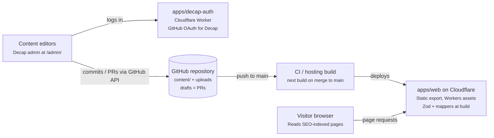
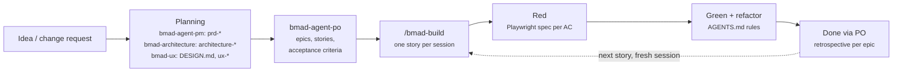

# Portfolio Platform — TypeScript, Next.js & Decap CMS Conventions

> Source of truth for humans. Agents read the condensed rules in [`/AGENTS.md`](../AGENTS.md).

## Overview and assumptions

The portfolio moves from a Roots stack (Bedrock + Sage + Trellis) to a TypeScript monorepo: a Next.js frontend that statically generates every page from Markdown and YAML files edited through Decap CMS. Content lives in git next to the code; there is no database and no CMS server. This guide fixes the naming, folder, method and content-model rules so every contributor writes the same code.

Assumptions this guide is built on:

- **Next.js (App Router) + React 19 + TypeScript strict**, statically exported at build time (`output: 'export'`), because a portfolio depends on SEO and speed.
- **Cloudflare** hosts everything: the export is deployed as Workers static assets, and a small Worker (`apps/decap-auth`) handles the GitHub login for Decap. The repository is `github.com/zzedgat2012/portfolio`.
- **Decap CMS 3** (git-based), GitHub backend in production with editorial workflow, local backend in development.
- **Content as files:** Markdown with YAML frontmatter for editorial entries, YAML for data and settings, media under `apps/web/public/uploads`.
- **pnpm workspaces + Turborepo** for the monorepo.
- Tailwind CSS is kept from Sage 10, so styling knowledge carries over.

Three principles drive every rule below:

1. **Files are a data source, not the domain.** The frontend never renders raw frontmatter; a Zod schema validates it and a mapper turns it into a domain model.
2. **The content model is defined once, in two mirrors that must agree:** Decap's `config.yml` (what editors see) and the Zod schemas in `packages/contracts` (what the code trusts). A test keeps them in sync.
3. **Names describe intent.** A reader knows from a function name whether it can return nothing, throw, or touch the file system.

## Architecture and monorepo layout

One deployable app. Editors save through Decap, which commits to GitHub; a merge to `main` triggers a build that turns the content files into static pages.



Editors work only in the Decap admin; visitors only get static HTML. Nothing at runtime reads the content: every page is rendered at build time.

```text
portfolio/
  apps/
    web/                Next.js frontend (App Router, static export)
      wrangler.jsonc    Workers static-assets deploy of out/
      public/admin/     Decap admin: index.html + config.yml
      public/uploads/   media managed by Decap
    decap-auth/         Cloudflare Worker: GitHub OAuth proxy for Decap
  content/              all site content, one file per entry
    projects/           <slug>.md
    pages/              <slug>.md
    categories/         <slug>.yml
    clients/            <slug>.yml
    settings/           site.yml, navigation.yml, redirects.yml
  packages/
    contracts/          domain types, Zod schemas for content files, error classes
    config/             shared tsconfig presets
    migrator/           WordPress → content files ETL scripts
  _bmad/                BMAD framework install (core files are never edited)
  _bmad-output/         BMAD planning artifacts: PRD, architecture, UX, epics, stories
  docs/
    conventions.md      this file
    ai/                 prompts for external agents (OpenPencil design agent)
  design/               OpenPencil mockups (portfolio.fig) and exports/
  external/             original WordPress theme repo (gitignored, read-only, last resort)
  .claude/              Claude Code rules (product, design system), skills and settings
  .mcp.json             MCP servers for Claude Code (open-pencil)
  AGENTS.md             condensed rules for coding agents
  CLAUDE.md             imports AGENTS.md for Claude Code
  DESIGN.md             visual system, owned by the BMAD UX skill
  turbo.json
  pnpm-workspace.yaml
```

Dependencies point one way: apps depend on packages, never on each other. `content/` sits at the root because three actors share it: the migrator writes it, Decap edits it, and the web app reads it.

Hosting decision (to be recorded in `architecture-*`): Cloudflare Workers static assets. A push to `main` runs `next build` (static export to `apps/web/out`) and `wrangler deploy`. Because there is no server, Next.js `redirects()`, rewrites, middleware and the image optimizer are unavailable: redirects are written to `out/_redirects` (Cloudflare's format) from `content/settings/redirects.yml`, and `images.unoptimized` is on. If the media library outgrows git, R2 behind a custom domain is the next step, proposed through `bmad-architecture`.

## Delivery workflow (BMAD)

Work is planned and delivered with the BMAD Method: planning skills produce the artifacts, the PO agent turns them into stories, and each story is implemented in one `/bmad-build` session that starts with failing Playwright specs.



### Who owns which artifact

| Artifact | Produced by | Lives in | Consumed by |
| --- | --- | --- | --- |
| `prd-*` | PM agent (`bmad-agent-pm`) | `_bmad-output/` | PO, architecture, build |
| `architecture-*` | `bmad-architecture` | `_bmad-output/` | build, reviewers |
| `DESIGN.md`, `ux-*` | `bmad-ux` | repo root / `_bmad-output/` | `apps/web` (via `.claude/rules/design-system.md`) |
| Epics, stories, ticket status | PO agent (`bmad-agent-po`) | `_bmad-output/` | `/bmad-build` |
| `bmad:context` block | `bmad-project-context` | `AGENTS.md` | every agent session |
| Conventions (this file) | team, by hand | `docs/` | humans; agents via AGENTS.md |

### Rules

- **Story = what, AGENTS.md = how.** Acceptance criteria define behavior; this guide and AGENTS.md define naming, structure and testing. A conflict is flagged back to the PO or architecture skill, never resolved silently in code.
- **No code without a story** (or an explicit, scoped task). Implementation always runs through `/bmad-build`, one story per session; start a fresh session for the next one to keep context clean.
- **Planning decisions flow back to planning.** A change to the content model or architecture is proposed to `bmad-architecture` and recorded in `architecture-*` before code lands.
- **`DESIGN.md` has one owner.** It is generated and changed through `bmad-ux`; components follow it, and a visual change starts there.
- **The `bmad:context` block in AGENTS.md** is managed by `bmad-project-context` and holds only what is costly to rediscover (pitfalls, caveats, non-default conventions). Everything else in AGENTS.md is maintained by hand, outside the markers.
- **BMAD customization** goes in its config and customization files, not in the core files under `_bmad/`, so upgrades do not overwrite it.
- **Traceability:** every acceptance criterion maps to at least one test; the story id appears in the Playwright `describe` title and in the commit message.

## TypeScript conventions

One casing rule per kind of symbol, enforced by Biome's `useNamingConvention` and `useFilenamingConvention` (see `biome.jsonc`) so reviews never argue about it.

### Naming

| Symbol | Casing | Example |
| --- | --- | --- |
| Type, interface, class | PascalCase, no `I` prefix | `Project`, `ProjectCardProps` |
| Function, method, variable | camelCase | `listProjects`, `projectSlug` |
| React component | PascalCase, one per file | `ProjectCard` |
| Hook | camelCase with `use` prefix | `useGalleryLightbox` |
| Module-level constant | UPPER_SNAKE_CASE | `DEFAULT_PAGE_SIZE` |
| Boolean | `is` / `has` / `can` / `should` prefix | `isFeatured`, `hasCoverImage` |
| Event handler (inside component) | `handle` + event | `handleFilterChange` |
| Event prop (component API) | `on` + event | `onFilterChange` |
| File (non-component) | kebab-case | `project-mapper.ts`, `content-source.ts` |
| File (component) | PascalCase | `ProjectCard.tsx` |
| File (Next.js convention) | the name Next.js requires | `page.tsx`, `layout.tsx`, `not-found.tsx` |
| Test file | source name + `.test` | `project-mapper.test.ts` |
| Content file schema / type | `…FileSchema` / `…File` | `projectFileSchema`, `ProjectFile` |

### Method verbs

The verb is a contract. Pick it by what the caller must handle, not by taste.

| Verb | Returns | Use when |
| --- | --- | --- |
| `get…` | `T`, throws `NotFoundError` | The item must exist (`getSiteSettings`, `getProjectBySlug` in a route with `dynamicParams = false`) |
| `find…` | `T \| null` | The item may not exist (`findProjectBySlug`) |
| `list…` | `Paginated<T>` or `T[]` | A collection, with filters (`listProjects`) |
| `create…` / `update…` / `delete…` | the written entity / `void` | File writes, only in `packages/migrator` |
| `to…` / `map…To…` | a new shape, pure | Mappers (`toProject`, `mapImageFieldToImage`) |
| `build…` | a value, pure | Builders of paths, URLs or metadata (`buildProjectMetadata`) |
| `assert…` | `asserts x is T` | Runtime guards that throw |
| `is…` / `has…` | `boolean` or `x is T` | Predicates and type guards |

Rules that differ from C#: no `Async` suffix (every I/O call is async in TS), no `Get` prefix on properties, and no `I` prefix on interfaces.

### Types

- `type` for unions, mapped types and file shapes; `interface` only for objects meant to be extended (component props may use either; pick `type` and stay consistent).
- No `any`. Use `unknown` at boundaries and narrow it with **Zod** schemas; derive the type with `z.infer`.
- No TS `enum`. Use string-literal unions or `as const` objects (smaller output, and they match Decap `select` options).
- Branded IDs for identifiers that cross module boundaries: `type Slug = string & { readonly __brand: 'Slug' }`.
- Discriminated unions for variants, with an exhaustive `switch` ending in an `assertNever(x)`.
- `tsconfig`: `strict`, `noUncheckedIndexedAccess`, `exactOptionalPropertyTypes`, `verbatimModuleSyntax`.

### Modules

- Named exports only; no default exports except where a framework requires them (Next.js route files, `next.config.ts`).
- `import type { … }` for type-only imports.
- Path aliases: `@/` inside an app, `@portfolio/<package>` across packages.
- A folder exposes one `index.ts` public API; deep imports into another feature are lint errors.

### Errors

- A small error hierarchy in `packages/contracts`: `AppError` → `NotFoundError`, `ValidationError`.
- An invalid content file throws `ValidationError` naming the file and the Zod issues, so a bad commit fails the build instead of shipping a broken page.
- Services throw; route boundaries (`not-found.tsx`, `error.tsx`) catch. No `try/catch` that only logs and rethrows.
- For expected failures in pure code, return a `Result<T, E>` union instead of throwing.

## Next.js frontend patterns

The frontend is organised by feature, and every content read flows through one path: content source → query function → mapper → Server Component.

### Folder layout (`apps/web/src`)

```text
app/                 routes and layouts (Next.js App Router)
  projects/[slug]/page.tsx
features/
  projects/
    content/         project-queries.ts, project-mapper.ts
    components/      ProjectCard.tsx, ProjectGrid.tsx
    hooks/           client-only UI hooks (use-gallery-lightbox.ts)
    model/           project.ts (domain type)
    index.ts         public API of the feature
  pages/  navigation/  settings/
blocks/              one component per page-section type + registry.tsx
shared/
  content/           content-source.ts (server-only file reader)
  ui/                design-system primitives (Button, Container, Image)
  lib/               pure helpers (format-date.ts, assert-never.ts)
```

### Content schemas (`packages/contracts`)

The file shapes live in `packages/contracts` so the migrator validates exactly what the web app will read.

```ts
// packages/contracts/src/content/project-file.ts
import { z } from 'zod';
import { seoSchema } from './seo';
import { sectionSchema } from './section';

export const projectFileSchema = z.object({
  title: z.string().min(1).max(120),
  shortDescription: z.string().max(280).optional(),
  coverImage: z.string().startsWith('/uploads/'),
  coverImageAlt: z.string().min(1),
  isFeatured: z.boolean().default(false),
  sortOrder: z.number().int().default(0),
  completedOn: z.iso.date().optional(),
  categories: z.array(z.string()).default([]), // category slugs
  client: z.string().optional(),                // client slug
  sections: z.array(sectionSchema).default([]),
  seo: seoSchema.optional(),
  legacyWpId: z.number().int().optional(),      // migration bookkeeping, never mapped
});

export type ProjectFile = z.infer<typeof projectFileSchema>;
```

### Data layer

```ts
// shared/content/content-source.ts  (server-only: runs at build time)
import 'server-only';
import { readdir, readFile } from 'node:fs/promises';
import path from 'node:path';
import matter from 'gray-matter';
import { parse as parseYaml } from 'yaml';
import type { z } from 'zod';
import { ValidationError } from '@portfolio/contracts';

const CONTENT_DIR = path.resolve(process.cwd(), process.env.CONTENT_DIR ?? '../../content');

export type Entry<T> = { slug: string; data: T; body: string };

// YAML 1.2 engine: keeps `2024-05-01` a string instead of a Date
const MATTER_OPTIONS = { engines: { yaml: (source: string) => parseYaml(source) as object } };

async function readEntry<S extends z.ZodType>(collection: string, file: string, schema: S) {
  const filePath = path.join(CONTENT_DIR, collection, file);
  const raw = await readFile(filePath, 'utf8');
  const { data, content } = file.endsWith('.md')
    ? matter(raw, MATTER_OPTIONS)
    : { data: parseYaml(raw) as unknown, content: '' };
  const parsed = schema.safeParse(data);
  if (!parsed.success) throw new ValidationError(`${filePath}: ${parsed.error.message}`);
  return { slug: path.parse(file).name, data: parsed.data as z.infer<S>, body: content };
}

export async function listEntries<S extends z.ZodType>(collection: string, schema: S) {
  const files = await readdir(path.join(CONTENT_DIR, collection));
  return Promise.all(files.map((file) => readEntry(collection, file, schema)));
}
```

```ts
// features/projects/content/project-queries.ts
import { NotFoundError, projectFileSchema } from '@portfolio/contracts';
import { listEntries } from '@/shared/content/content-source';
import { toProject } from './project-mapper';
import type { Project } from '../model/project';

export async function listProjects(): Promise<Project[]> {
  const entries = await listEntries('projects', projectFileSchema);
  return entries.map(toProject).sort((a, b) => a.sortOrder - b.sortOrder);
}

export async function getProjectBySlug(slug: string): Promise<Project> {
  const project = (await listProjects()).find((p) => p.slug === slug);
  if (!project) throw new NotFoundError(`project ${slug}`);
  return project;
}
```

```tsx
// app/projects/[slug]/page.tsx
import { getProjectBySlug, listProjects, ProjectDetail } from '@/features/projects';

export const dynamicParams = false; // unknown slugs are 404 at build time

export async function generateStaticParams() {
  return (await listProjects()).map((project) => ({ slug: project.slug }));
}

export default async function ProjectRoute({ params }: { params: Promise<{ slug: string }> }) {
  const { slug } = await params;
  return <ProjectDetail project={await getProjectBySlug(slug)} />;
}
```

- **Server Components read content; nothing is fetched in the browser.** There is no TanStack Query and no API route for content: everything the page needs exists at build time.
- **Mappers are the anti-corruption layer.** `toProject` turns a validated `Entry<ProjectFile>` into the domain `Project`: it resolves relation slugs, renames fields where the domain wants a different shape, and drops `legacyWpId`. Components never see raw frontmatter.
- **`CONTENT_DIR`** selects the content root (real content by default, `e2e/content` in tests). It is not a secret and needs no `NEXT_PUBLIC_` prefix, because only server code reads it.
- **No secrets in the web app.** Decap authenticates editors through GitHub OAuth; the web build needs no token at all.

### Page-section rendering

A page body is a list of sections (`sections`, Decap's list widget with `types`). Each item carries a `type` field; a registry maps it to a React component, and the compiler checks that every type is handled.

```tsx
// blocks/registry.tsx
import type { Section } from '@/features/pages/model/section';
import { assertNever } from '@/shared/lib/assert-never';
import { HeroBlock } from './HeroBlock';
import { RichTextBlock } from './RichTextBlock';
import { GalleryBlock } from './GalleryBlock';

export function renderSection(section: Section, index: number) {
  switch (section.type) {
    case 'hero': return <HeroBlock key={index} {...section} />;
    case 'rich-text': return <RichTextBlock key={index} {...section} />;
    case 'gallery': return <GalleryBlock key={index} {...section} />;
    default: return assertNever(section);
  }
}
```

The Zod `sectionSchema` is a `z.discriminatedUnion('type', [...])` whose variants mirror the `types` entries in `config.yml` one-to-one.

### Component rules

- Components are function components with a typed `Props` type in the same file. Server Components by default; add `'use client'` only for interactivity, as low in the tree as possible.
- Presentational components in `shared/ui` read no content; feature components may receive domain models from their route.
- Rich text is Markdown from Decap's `markdown` widget, rendered with `react-markdown` (plus `remark-gfm` if needed). Never enable raw HTML (`rehype-raw`) and never use `dangerouslySetInnerHTML`.
- Images use `next/image`; paths come from the content as `/uploads/…`, and alt text is a required field next to every image.

## Decap CMS patterns

Keep Decap close to its defaults: one static admin page, one `config.yml`, and the editorial workflow so nothing reaches `main` without being published.

### Admin layout (`apps/web/public/admin`)

```text
index.html     loads decap-cms from a CDN at a pinned exact version (no npm install, no React clash)
config.yml     backend, media folders, collections and fields (the content model)
```

### Configuration

```yaml
# apps/web/public/admin/config.yml
backend:
  name: github
  repo: zzedgat2012/portfolio
  branch: main
  base_url: https://<decap-auth-worker-host>   # apps/decap-auth; no secret here
local_backend: true                       # used when `pnpm cms:local` runs
publish_mode: editorial_workflow
media_folder: apps/web/public/uploads
public_folder: /uploads

collections:
  - name: projects
    label: Projects
    folder: content/projects
    create: true
    extension: md
    format: frontmatter
    slug: "{{slug}}"
    identifier_field: title
    fields:
      - { name: title, label: Title, widget: string, pattern: ['^.{1,120}$', 'At most 120 characters'] }
      - { name: shortDescription, label: Short description, widget: text, required: false }
      - { name: coverImage, label: Cover image, widget: image }
      - { name: coverImageAlt, label: Cover image alt text, widget: string }
      - { name: isFeatured, label: Featured, widget: boolean, default: false }
      - { name: sortOrder, label: Sort order, widget: number, value_type: int, default: 0 }
      - { name: completedOn, label: Completed on, widget: datetime, time_format: false, date_format: YYYY-MM-DD, format: YYYY-MM-DD, required: false }
      - { name: categories, label: Categories, widget: relation, collection: categories, value_field: "{{slug}}", search_fields: [name], display_fields: [name], multiple: true, required: false }
      - { name: client, label: Client, widget: relation, collection: clients, value_field: "{{slug}}", search_fields: [name], display_fields: [name], required: false }
      - name: sections
        label: Sections
        widget: list
        required: false
        types:
          - { name: hero, label: Hero, widget: object, fields: [{ name: heading, widget: string }, { name: image, widget: image }] }
          - { name: rich-text, label: Rich text, widget: object, fields: [{ name: body, widget: markdown }] }
          - { name: gallery, label: Gallery, widget: object, fields: [{ name: images, widget: list, fields: [{ name: src, widget: image }, { name: alt, widget: string }] }] }
      - { name: seo, label: SEO, widget: object, required: false, fields: [{ name: title, widget: string }, { name: description, widget: text }] }
      - { name: legacyWpId, widget: hidden, required: false }

  - name: settings
    label: Settings
    files:
      - { name: site, label: Site, file: content/settings/site.yml, fields: [...] }
      - { name: navigation, label: Navigation, file: content/settings/navigation.yml, fields: [...] }
```

### Decap rules

- **One model, two mirrors.** Every field exists in `config.yml` and in the Zod schema with the same name, the same required-ness and the same constraints. A Vitest test loads `config.yml`, compares each collection's field names with the schema's keys, and fails on any difference.
- **Every file parses.** A Vitest test runs every file in `content/` and `apps/web/e2e/content/` through its schema and checks that every relation slug points to an existing entry. It runs in `pnpm turbo test`, so CI catches a bad editor commit before the build does.
- **Editorial workflow is the draft system.** Unpublished work lives on `cms/…` branches as pull requests; `main` is always the published site. There is no `isDraft` field.
- **Local development** uses `local_backend: true` with `decap-server` (`pnpm cms:local`): the admin at `http://localhost:3000/admin/index.html` writes straight to the working tree, with no login. The local backend skips the editorial workflow, so commit or discard the changes yourself.
- **Authentication:** the GitHub backend needs an OAuth proxy at `base_url`: `apps/decap-auth`, a Cloudflare Worker. It redirects to GitHub with a random `state` (kept in an HttpOnly cookie), exchanges the code for a token, and hands the token to the admin window via `postMessage`, only for origins in `ALLOWED_ORIGINS`. The GitHub OAuth app's client secret is a Worker secret (`wrangler secret put GITHUB_CLIENT_SECRET`), never in the repository.
- **Access control is GitHub:** an editor is a collaborator with write access. Branch protection on `main` decides who may publish.
- **Media** stays in the repository under `apps/web/public/uploads`. Upload images web-sized; if the folder grows past what git handles comfortably, propose an external media library through `bmad-architecture`.
- **Pin Decap** to an exact version in `index.html` and upgrade it deliberately, checking the admin by hand after the upgrade.

## Content model

Model content in `config.yml` and the matching Zod schemas, and nowhere else. A file in `content/` that Decap cannot show, or a field Zod does not know, is a bug.

### Building blocks and when to use each

| Decap construct | Use for | Portfolio examples |
| --- | --- | --- |
| Folder collection | Entities with many entries, own URL or relations | `projects`, `pages`, `posts`, `categories`, `tags`, `clients`, `testimonials` |
| File collection | One-of-a-kind content | `settings/site`, `settings/navigation`, `settings/redirects`, `settings/home` |
| Object widget | Reusable field groups owned by one parent, no own URL | `seo`, `link`, `mediaWithCaption` |
| List widget with `types` | Ordered, flexible page sections chosen by the editor | `sections` on `pages` and `projects` |
| Relation widget | Links between independent entries (stores the target slug) | `projects` → `categories` (multiple) |

Decision rule: if editors need to reuse or list it on its own, it is a folder collection referenced by a relation; if it only exists inside its parent, it is an object widget.

### Content naming

| Item | Rule | Example |
| --- | --- | --- |
| Collection `name` and folder | kebab-case, plural, English | `projects`, `case-studies` → `content/case-studies/` |
| `label` | Title Case, what editors see | `Case Studies` |
| Entry file | the slug, kebab-case | `content/projects/brand-refresh.md` |
| Field | camelCase | `shortDescription` |
| Boolean field | `is` / `has` prefix | `isFeatured` |
| Date field | `…On`, stored as `YYYY-MM-DD` | `completedOn` |
| Section type | kebab-case, singular | `hero`, `rich-text`, `gallery` |
| Relation field | the target in the right number | `categories` (multiple), `client` (single) |

Never name a field `slug` (the file name is the slug) or `type` outside a section (it is the section discriminator).

### Modeling rules

- **The slug is the identity.** It is the file name, generated from the title (`slug: "{{slug}}"`). Routes resolve by slug. Renaming a published entry's file changes its URL, so it needs a redirect entry.
- **Relations are one-way** (Decap stores the slug on one side). Compute the reverse side in the mapper, such as "projects in this category"; never store both sides.
- **Nesting stays shallow:** at most two levels of nested object/list widgets. Deeper nesting makes the editor UI hard to use and the schemas fragile.
- **Sections** hold page layout, not data that must be filtered or sorted; anything you filter or sort on is a top-level field.
- **Validate in both places:** `required`, `pattern`, `min`/`max` in `config.yml` for the editor experience; the same rules in Zod, which is the authority at build time.
- **Changing a field** (rename, new required field, type change) ships with a script in `packages/migrator` that rewrites the existing files, in the same commit.
- **i18n** only if the site is multilingual (PT/EN); Decap's `i18n` option reshapes the folders, so decide before the first migration.
- **Hidden fields** (`widget: hidden`) for migration bookkeeping such as `legacyWpId`; mappers drop them.

## WordPress to content files mapping

Every Roots-stack concept has a direct home; the migration is an idempotent TypeScript ETL keyed on the WordPress ID.

| WordPress / Roots | Becomes | Notes |
| --- | --- | --- |
| Custom post type (`project`, `portfolio`) | Folder collection | One per CPT |
| Pages | `pages` folder collection with `sections` | Homepage becomes a file collection if its layout is fixed |
| Posts | `posts` folder collection | Only if the blog is kept |
| Taxonomies (categories, tags, custom) | Folder collections + relation widgets | Keep slugs for URL redirects |
| ACF field groups | Fields or object widgets | Repeaters become list widgets |
| ACF flexible content / Gutenberg blocks | `sections` types | One type per layout |
| ACF options page | File collection (`settings/site`) | |
| Menus | File collection `settings/navigation` with a list of links | |
| Yoast / Rank Math meta | `seo` object widget | Title, description, OG image, canonical |
| Media library | Files in `apps/web/public/uploads` | Download originals once; keep alt text and captions |
| Bedrock `.env` / `config/` | `next.config.ts` + `.env` | Same twelve-factor idea; content needs no secrets |
| Sage Blade views + Tailwind | React components + Tailwind | Port partials one-to-one into `blocks/` |
| Trellis (Ansible provisioning) | `wrangler deploy` on push to `main` | No servers to provision |

### Migration steps

1. **Freeze the model:** write `config.yml` and the Zod schemas and review them before importing anything.
2. **Extract** from the WP REST API (`/wp-json/wp/v2/…`, with ACF exposed) or WP-CLI exports into JSON files kept outside `content/` (scratch, not committed).
3. **Transform** in `packages/migrator` (TypeScript, Zod-validated): HTML content to Markdown, ACF layouts to `sections` items, media URLs to `/uploads/…` paths.
4. **Load** by writing files: `content/<collection>/<slug>.md|yml` and media into `apps/web/public/uploads/`. Match existing files by `legacyWpId` and overwrite them, so re-running never duplicates.
5. **Order of load:** media → taxonomies → clients → projects/pages → navigation and settings.
6. **Redirects:** generate `content/settings/redirects.yml` mapping old WP permalinks to new routes; the web app turns it into 301s.
7. **Verify:** run the content tests, compare entry counts per type with WordPress, spot-check pages visually, then commit the content in one reviewed PR.

### The original theme in `external/` (last resort)

The original WordPress theme repository is kept locally in `external/`. It is in `.gitignore`, so it may be
missing on a fresh clone, and it is never part of the build.

| Question | Look here first | `external/` only if still unanswered |
| --- | --- | --- |
| What must this page do? | BMAD story and PRD | rendering logic in Sage views and controllers |
| How must it look? | `DESIGN.md` and the OpenPencil mockup | Blade partials and the old Tailwind config |
| Which fields does this content have? | `config.yml`, the Zod schemas and migrated files | ACF field group exports (`acf-json/`) |
| Which old URLs must redirect? | `content/settings/redirects.yml` | permalink and rewrite rules in the theme |

Rules:

- **Read-only.** Never modify, import from, or build against it; never copy PHP, Blade or JS verbatim.
  Translate what you learn into the conventions of this guide.
- **Targeted reads.** Open the specific file that answers the question; never scan or index the folder
  (agents on metered plans pay for every file read).
- **Lowest precedence.** BMAD artifacts, `DESIGN.md` and mockups override it. A difference is reported, not
  silently reproduced, because some old behaviors are exactly what the port is meant to fix.
- **Close the gap.** When it had to be consulted, the files read go in the report, and the missing
  information is added to the story or the relevant BMAD artifact so the next reader does not need it.

## Tooling, testing and CI

One toolchain for the whole repo, shared through `packages/config`, and a CI pipeline that fails on any rule in this guide.

| Concern | Tool | Notes |
| --- | --- | --- |
| Package manager / monorepo | pnpm workspaces + Turborepo | Cached `build`, `lint`, `test` per package |
| Lint + format + import sorting | Biome v2 (`biome.jsonc` at the root) | Naming and file-name conventions, `noExplicitAny`, `noEnum`, `noDefaultExport` (except Next.js route files), `useImportType`; run on commit via lint-staged |
| Editor defaults | `.editorconfig` | 2 spaces, LF, 100 columns; Biome reads it (`useEditorconfig`) |
| Unit tests | Vitest + Testing Library | Mappers, schemas, content source, block components |
| Content tests | Vitest | Every content file parses; relations resolve; `config.yml` ↔ Zod field parity |
| End-to-end (TDD driver) | Playwright | Written first for every user-facing change; runs against a production build of fixture content |
| Local CMS | `decap-server` (`pnpm cms:local`) | Admin at `/admin/index.html` writes to the working tree |
| Hosting and deploy | Cloudflare Workers + Wrangler | `apps/web` (static assets) and `apps/decap-auth` (OAuth Worker) |
| Commits | Conventional Commits | `feat(web): add case-study collection` |

### TDD with Playwright

Development is test-first and outside-in: a failing Playwright spec describes what the visitor sees, then the code makes it pass. Units below the page (mappers, schemas, the content source) follow the same red-green-refactor loop with Vitest.

1. **Red:** write the spec, run it, and confirm it fails for the right reason (missing behavior, not a typo or broken locator).
2. **Green:** implement the minimum to pass.
3. **Refactor** with the suite green; commit spec and code together.

```text
apps/web/e2e/
  content/                  fixture content, same layout as content/ (seed-… slugs)
    projects/seed-project-with-gallery.md
    projects/seed-project-without-gallery.md
  fixtures.ts               test.extend: page objects
  pages/project-page.ts     page object, methods named by user intent
  projects/
    featured-projects.spec.ts
    project-gallery.spec.ts
```

```ts
// apps/web/playwright.config.ts (excerpt): the same static export Cloudflare serves
webServer: {
  command: 'pnpm build && pnpm exec wrangler dev --port 3000',
  env: { CONTENT_DIR: 'e2e/content' },
  url: 'http://localhost:3000',
  reuseExistingServer: !process.env.CI,
},
```

```ts
// apps/web/e2e/fixtures.ts
import { test as base } from '@playwright/test';
import { ProjectPage } from './pages/project-page';

type Fixtures = { projectPage: ProjectPage };

export const test = base.extend<Fixtures>({
  projectPage: async ({ page }, use) => {
    await use(new ProjectPage(page));
  },
});
export { expect } from '@playwright/test';
```

```ts
// apps/web/e2e/pages/project-page.ts
import type { Page, Locator } from '@playwright/test';

export class ProjectPage {
  readonly heading: Locator;
  readonly gallery: Locator;

  constructor(private readonly page: Page) {
    this.heading = page.getByRole('heading', { level: 1 });
    this.gallery = page.getByRole('region', { name: 'Gallery' });
  }

  async openProject(slug: string) {
    await this.page.goto(`/projects/${slug}`);
  }
}
```

```ts
// apps/web/e2e/projects/project-gallery.spec.ts
import { test, expect } from '../fixtures';

// One test (or more) per acceptance criterion of BMAD story 2.3
test.describe('[story 2.3] Project page', () => {
  test('shows the gallery when the project has images @smoke', async ({ projectPage }) => {
    await projectPage.openProject('seed-project-with-gallery');

    await expect(projectPage.heading).toHaveText('Seed project with gallery');
    await expect(projectPage.gallery.getByRole('img')).toHaveCount(3);
  });

  test('hides the gallery when the project has no images', async ({ projectPage }) => {
    await projectPage.openProject('seed-project-without-gallery');

    await expect(projectPage.gallery).toBeHidden();
  });
});
```

Rules:

- **Locators by accessibility first:** `getByRole`, `getByLabel`, `getByText`; `getByTestId` only as a last resort; never CSS or XPath. This also keeps the UI accessible, since a spec cannot find what a screen reader cannot.
- **Web-first assertions** (`toBeVisible`, `toHaveText`, `toHaveCount`) that retry; never `page.waitForTimeout`.
- **Real build, fixture content.** E2E runs against the static export served by `wrangler dev` with `CONTENT_DIR=e2e/content`, committed fixture files with fixed slugs (`seed-…`). Tests never depend on real editorial content, so an editor's change cannot break CI. Do not stub with `page.route`: pages are rendered at build time on the server, so the stub would never be hit.
- **Independent tests:** no shared state, no reliance on order; `fullyParallel: true` in `playwright.config.ts`.
- **Names describe behavior** from the visitor's point of view, in the present tense.
- **Tags:** `@smoke` marks the critical path; CI runs `--grep @smoke` on every PR and the full suite on `main`.
- **Hygiene:** `forbidOnly: !!process.env.CI`; no skipped test without a linked issue; traces and videos `on-first-retry`.
- Every new section type gets fixture content and a spec proving it renders.
- The Decap admin itself is not covered by E2E; its contract is guarded by the `config.yml` ↔ Zod parity test.
- `playwright codegen` is for discovering locators only; rewrite its output to these rules.

### Definition of done for a change

- [ ] Every acceptance criterion of the BMAD story is covered by a test carrying the story id
- [ ] A Playwright spec (or Vitest test for units) was written first and failed before the change
- [ ] `pnpm turbo lint typecheck test` and `pnpm --filter web test:e2e` pass
- [ ] `config.yml`, Zod schema, mapper and e2e fixture content updated together for any model change
- [ ] New section type has a Decap type, a block component, a registry case, fixture content and a spec
- [ ] Existing content files rewritten by a migrator script for any renamed or newly required field
- [ ] Redirect added for any changed slug or route
- [ ] Commit references the story (`feat(web): project gallery (story 2.3)`); story status updated via the PO agent

## C#/.NET equivalence cheat sheet

Most patterns here have a direct .NET counterpart; the main shift is that TypeScript types vanish at runtime, so boundaries need Zod.

| .NET | This stack | Difference to watch |
| --- | --- | --- |
| Entity Framework model + migrations | Decap `config.yml` + Zod schemas; migrator scripts rewrite files | No database: a "migration" edits Markdown/YAML in git |
| `DbContext` / repository | `content-source.ts` + query functions | Reads files at build time, not per request |
| `IQueryable` + `.Include()` | Array `filter` / `map` + resolving relation slugs in the mapper | Everything is in memory during the build |
| Service layer | Query functions in `features/*/content` | Same role |
| Controller / Razor page | Next.js Server Component `page.tsx` | Rendered once at build, served as static HTML |
| `[Authorize]` policies | GitHub repository permissions + branch protection | Only editors write; visitors only read static files |
| DataAnnotations / FluentValidation | Zod + Decap widget validation | Zod also gives you the type (`z.infer`) |
| DTO + AutoMapper | `…File` type + hand-written mapper | Mappers are plain pure functions |
| `Task<T>` + `Async` suffix | `Promise<T>`, no suffix | Everything I/O is async |
| LINQ `Where` / `Select` | `filter` / `map` on arrays | Eager, not deferred |
| `enum` | String-literal union or `as const` | No runtime enum object |
| xUnit / NUnit | Vitest | Jest-compatible API |
| NuGet + solution | pnpm workspaces + Turborepo | Packages are folders in one repo |
